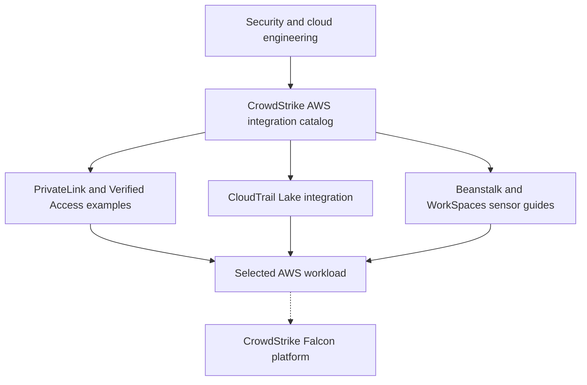

# CrowdStrike AWS Integration Examples

A fork of [CrowdStrike/Cloud-AWS](https://github.com/CrowdStrike/Cloud-AWS), collecting AWS integration guides, CloudFormation examples and Falcon sensor deployment material.

**Status:** This is an integration catalog. The examples are separate solutions, and some catalog entries link to other upstream repositories.

## Integration map

## Start here

Start with [PrivateLink](aws-privatelink/README.md), [CloudTrail Lake](cloudtrail-lake/README.md), [Verified Access](verified-access/README.md), [Elastic Beanstalk](beanstalk/README.md) or [WorkSpaces](workspaces/README.md). Each guide defines its own prerequisites and deployment steps. The complete upstream integration catalog is retained in the reference guide.

[Previous README and detailed reference](https://github.com/mtzanida/Cloud-AWS/blob/6d00c2101be3e883291784cf6af20ee28aeaca45/README.md) are retained in Git history. They may describe older assumptions or unmerged plans; the scope above reflects this branch.
